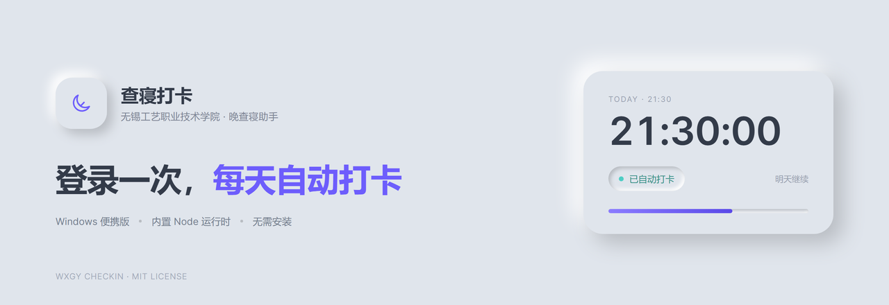
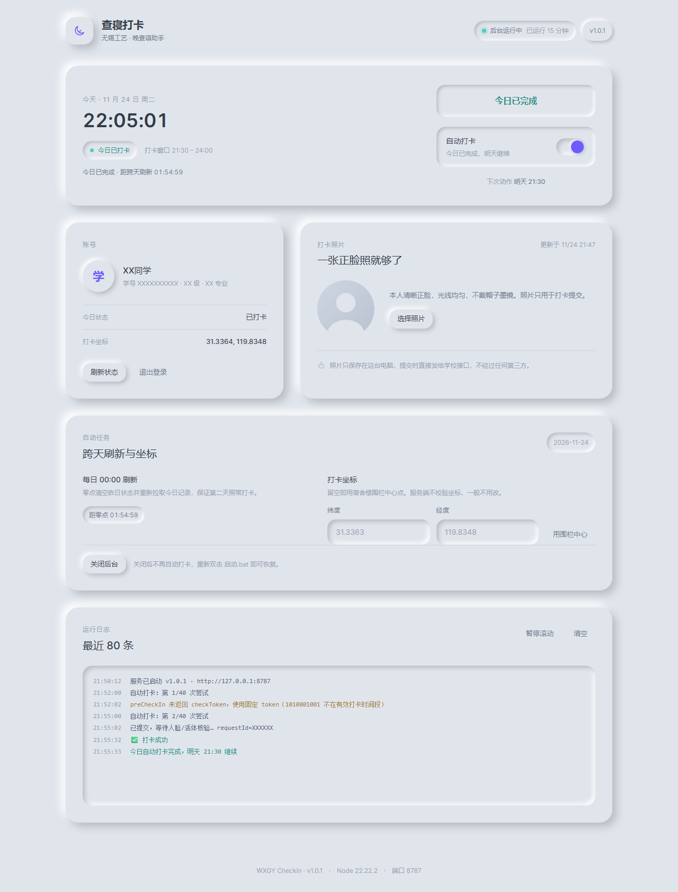
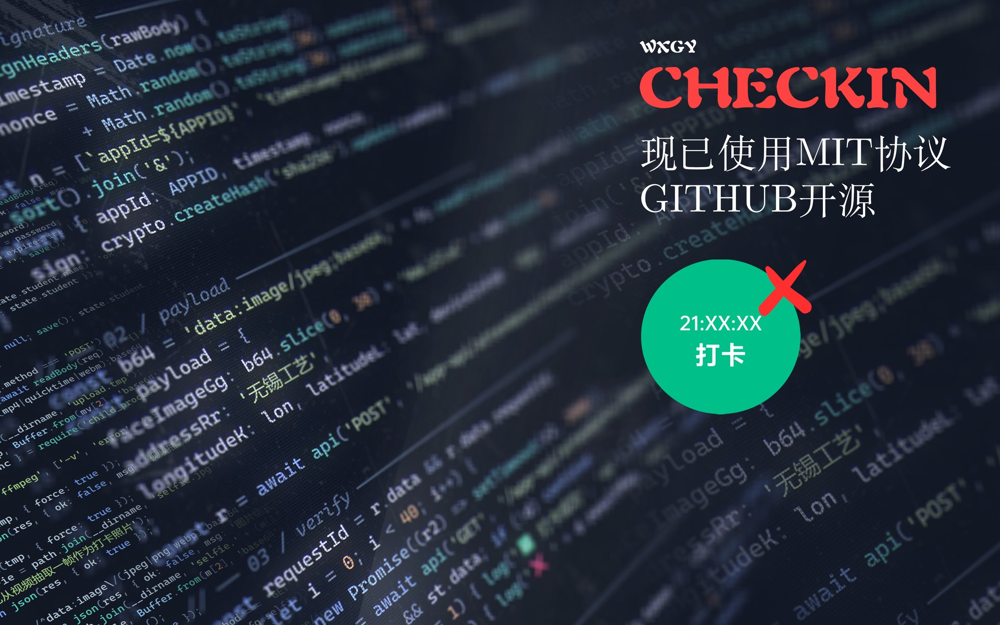

# 查寝打卡助手WXGY-checkin

<p align="center">
  
</p>

<p align="center">

  <a href="https://github.com/AaronShawn/wxgy-checkin/releases/latest"></a>

  <a href="https://github.com/AaronShawn/wxgy-checkin/releases"></a>

  

  
</p>

把无锡工艺职业技术学院的晚查寝打卡放到电脑上：**登录一次，传一张正脸照，之后每天 21:30 自动完成**。

> **仅供学习研究。** 本项目复刻的是一条绕过地理围栏、用静态照片通过活体检测的流程。拿它完成实际考勤属于伪造考勤记录，可能被认定为违纪。是否使用、后果如何，由使用者自行承担，详见[免责声明](#免责声明)。

## 界面预览

<p align="center">
  
</p>

## 下载与使用

到 [**Releases**](https://github.com/AaronShawn/wxgy-checkin/releases/latest) 下载，两种任选：

| 文件 | 用法 |
| --- | --- |
| `wxgy-checkin-v1.0.1-portable-win64.exe` | 单文件，双击即用；首次运行释放到 `%LOCALAPPDATA%\WXGY-Checkin\app` |
| `wxgy-checkin-v1.0.1-portable-win64.zip` | 解压到任意目录（路径可含中文），双击 `启动.bat` |

1. 双击 exe，或解压后双击 `启动.bat`；
2. 浏览器会自动打开 `http://127.0.0.1:8787`，用学号、密码登录；
3. 传一张清晰正脸照，打开「自动打卡」开关。

不需要安装 Node.js 或任何运行库。zip 版数据在解压目录；exe 版数据在 `%LOCALAPPDATA%\WXGY-Checkin\app`，换新版 exe 不会丢配置。下载量会显示在顶部 `downloads` 徽章上（数据来自 GitHub 的 Release 统计）。

## 它能做什么

- **每天自动打卡**：21:30 开放后自动提交，成功后立即停手，失败每 3 分钟重试一次。

- **跨天自动重置**：00:00 清空昨日状态并重新拉取今日打卡状态，第二天照常，不用重启服务。

- **请假 / 免查寝自动跳过**：识别到当天不用打卡就不提交。

- **只在本机运行**：服务只监听 `127.0.0.1`，账密与照片不经过任何第三方。

## 自动打卡怎么跑

```

21:30 ─────────────── 打卡窗口 ─────────────── 24:00 ── 00:00

  │  每 3 分钟试一次，成功即停；失败退避重试（单日上限 40 次）  │        │

  └──────────────────────────────────────────────┘        │

                                                          零点定时器 + 30 秒看门狗

                                                          清空昨日状态、重置计数

```

- **执行者是后台进程，不是网页**：关掉浏览器不影响打卡，关掉 `启动.bat` 窗口才会停。

- **跨天靠日期判断**：零点定时器之外还有每 30 秒一次的日期比对，电脑休眠唤醒、改过系统时间也能补上重置。

- **零点脏数据不误判**：学校接口在 00:00 后可能仍返回昨天的记录，此时重试 3 次；仍对不上就按「状态未知」处理，绝不会把昨天的「已打卡」当成今天。

## 本版更新（v1.0.1）

| 项目 | 说明 |

| --- | --- |

| 跨天修复 | 今日状态按日期打标、过期失效，零点自动重置，解决第二天不打卡的问题。 |

| 便携运行 | 发行包内置 Node.js 22.22.2，解压双击即用，无需安装任何前置。 |

| 界面重做 | 极简新拟物风格：同色基底、固定左上光源、凸起 / 凹陷双阴影，重写仪表盘与日志面板。 |

| 稳定性 | 请求超时、配置原子写入、坐标校验、Host 白名单、单实例端口检测。 |

## 实测结论

| 闸门 | 实际在哪 | 能不能绕 |

| --- | --- | --- |

| 21:30 时间窗 | 服务端强制（提前提交返回 `1010001001 不在有效打卡时间段`） | 不能，等点或交给自动重试 |

| 地理围栏 | 只在校内学生信息页前端做多边形判定 | 能，服务端完全不校验坐标 |

| 活体检测 | 服务端异步（`status` 0 待检 / 1 成功 / 2 失败） | 能，为单帧静默活体，任意清晰正脸照通过 |

| 人脸比对 | 服务端异步，同上 | 用本人照片 |

## 原理摘要

1. **登录**：走学校 CAS OAuth2。登录页把密码倒序后做 RSA（PKCS#1 v1.5）加密再提交，验证码 DOM 被 CSS 隐藏，无需识别。拿到 `ST-` ticket 后换 `accessToken`。

2. **签名**：`appId=wxgycq` + `timestamp` + `nonce` 排序拼接 `&`，接原始 JSON body 与密钥 `wxgycq#2026` 做 SHA-256，结果放进 `sign` 头。

3. **提交**：`POST /app-api/attendance/check/studentChecKlnSecret`，字段名故意写歪（`faceImageGg / addressRr / longitudeK / latitudeL / deviceInfoR / checkToken`），照片是 JPEG data URL，并在第 30 个字符处插入标记 `KwLiSlaC`。

4. **结果**：返回 `requestId` 后每 2 秒轮询 `/app-api/attendance/check/status/{requestId}`；重复提交会返回 `ALREADY_CHECKED_IN`。

## 常见问题

**提示「不在有效打卡时间段」？** 服务端 21:30 才放行，等点或交给自动开关。

**提示「不在打卡范围内」？** 那是校内网页自己的判定，本工具默认使用围栏中心坐标，正常不会遇到。

**打卡失败，`status=2`？** 看日志里的 `resultMsg`，多数是照片模糊、侧脸或多人，换一张正脸照。

**关掉网页还会自动打卡吗？** 会。网页只是面板，执行者是后台进程。

**电脑重启后还要做什么？** 重新双击 `启动.bat`。本版不提供开机自启。

**过了零点状态还是昨天的？** 本版已修：零点自动重置，也可以点「刷新状态」强制拉取。若页面日期不对，`Ctrl+F5` 刷新。

**重复双击会起两个吗？** 不会。脚本先探测 8787 是否在监听，已在运行就只打开页面；exe 重复双击也是同样结果。

**exe 版的数据在哪？** `%LOCALAPPDATA%\WXGY-Checkin\app`。想彻底清掉，退出后台后删掉 `WXGY-Checkin` 文件夹即可。

## 目录

```

server.js          # 本地服务：登录、签名、打卡、状态轮询、调度

lib/day.js         # 日期与 21:30–24:00 窗口计算

lib/daykeeper.js   # 跨天看门狗：零点定时器 + 30 秒日期比对

cas_security.js    # CAS 登录页的 RSA 实现

public/            # 界面：index.html / app.css / app.js

启动.bat            # 启动服务并打开页面

test/              # 跨天与窗口边界的单元测试

docs/              # banner 与界面截图

data.json          # 运行时生成：配置与登录态（不入库）

app.log            # 运行时生成：日志，超过 1 MB 轮转（不入库）

```

开发：

```bash

npm start      # 启动服务（默认 127.0.0.1:8787）

npm test       # 单元测试

node server.js --no-browser   # 启动但不打开浏览器

```

## 海报

<p align="center">
  
</p>

## 免责声明

**一句话**：这是给开发者看的技术笔记，不是打卡服务。拿它打卡的后果，全部由使用者自己承担。

1. **用途限定。** 仅用于个人学习、Node.js 实践与 Web 端鉴权 / 签名机制研究。作者不提供打卡服务，不代打卡，不对任何账号的打卡结果负责。

2. **违纪风险。** 本项目具备绕过前端地理围栏、用单张照片通过静默活体、定时自动重试的能力。把这些能力用于实际考勤，性质是**伪造考勤记录**，可能违反校纪校规并受到处分（严重者涉及学籍处理）。

3. **账号与数据风险。** 学号、密码、token 以明文保存在本机 `data.json`，照片保存在本机；作者不收集、不上传、无法获取任何使用者数据。请勿在公共或他人设备上运行；频繁请求可能触发学校系统风控，导致账号受限或封禁。

4. **可用性风险。** 打卡能否成功取决于学校系统当时的实现。接口改版、参数增删、加签变更、时间窗调整都会让工具失效或产生错误记录。作者不承诺可用性、准确性、及时性。

5. **无关联声明。** 本项目与无锡工艺职业技术学院及其任何部门无隶属、合作或授权关系，未获其认可。站点接口、页面、名称及相关标识归权利人所有；本项目仅出于互操作性目的引用公开可见的前端逻辑。

6. **责任与权利。** 软件按 MIT 协议「按原样」提供，不附带任何明示或暗示的担保；因使用或无法使用本项目产生的直接或间接损失（含处分、成绩影响、账号封禁、数据丢失），作者与贡献者均不承担责任。相关单位如认为内容不当或侵犯权益，请提 issue 说明，核实后会删除相关内容。

如果你只是不想漏打，正解是把 `启动.bat` 当提醒器用、人确实在宿舍；这条工具链存在的意义是看清「前端的围栏校验能有多不牢」，而不是帮你把不在场变成在场。

## 许可

[MIT](LICENSE) © 2026 wxgy-checkin contributors

`cas_security.js` 为 David Shapiro 的 RSA JavaScript 实现（文件头保留原版权声明，经 CAS 页面二次分发），其条款归原作者，不在本仓库 MIT 授权范围内。

发行包内的 `runtime/node.exe` 来自 Node.js 官方发行版，按其 MIT 许可分发，许可证全文见包内 `runtime/LICENSE`。

